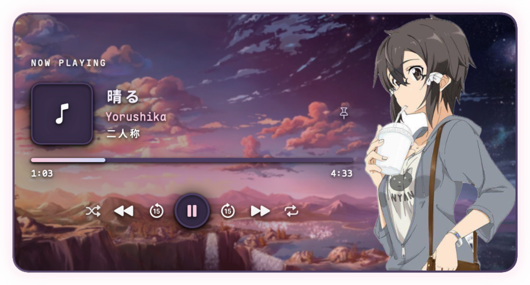
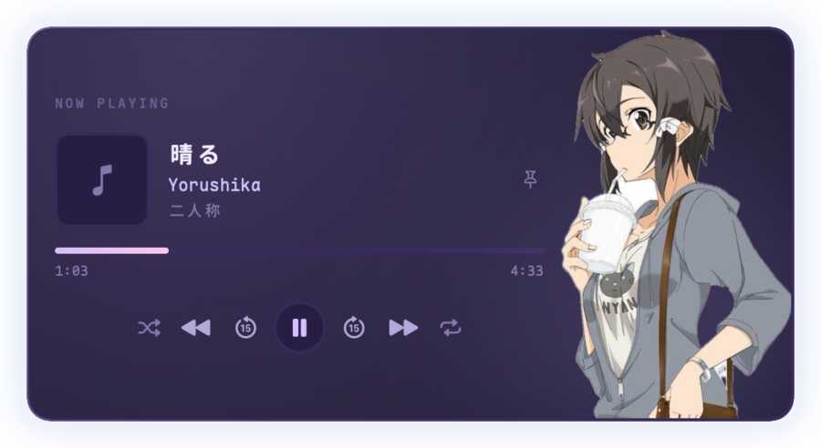
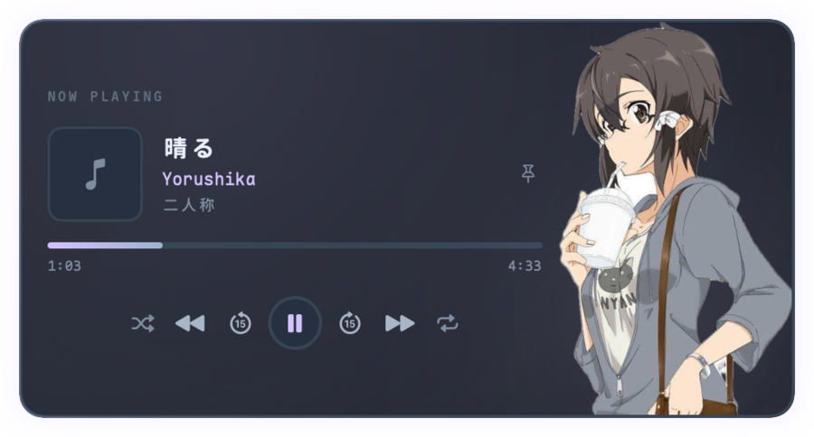

# Vodya

A small "Now Playing" card that floats over your Mac. Album art, title, artist, a
live scrubber and working controls — and a look you can make your own: swap the
palette, drop in your own background and character art, colour the border light,
then save the whole thing as a preset.



## Features

- **⌥P** toggles the card from anywhere; **⌥⇧P** pins it to the screen.
- Shuffle · previous · back 15s · play/pause · forward 15s · next · repeat.
- Drag it anywhere, it remembers where it was. Click outside to dismiss.
- Four palettes (Petal, Soft Purple, Mist, Mono), three sizes, blur or solid.
- **Your own art**: any image as the card background, a PNG as the character.
- **Edge light**: a thin coloured rim on the border — on/off, adjustable strength and colour.
- **Presets**: save the current look under a name and recall it in one click.
- Everything lives in a hand-editable `config.json` that hot-reloads on save.



## Install

Grab `Vodya-<version>-universal.zip` from the
[releases page](../../releases), unzip it and move `Vodya.app` to `/Applications`.

The app is ad-hoc signed (there is no paid Developer ID), so the first launch
needs **right-click → Open**, or:

```sh
xattr -dr com.apple.quarantine /Applications/Vodya.app
```

Requires macOS 14 or newer and [`media-control`](https://github.com/ungive/media-control):

```sh
brew install media-control
```

## Build from source

```sh
./build.sh                 # build/Vodya.app (arm64, quick)
open build/Vodya.app
./tools/release.sh         # dist/Vodya-<version>-universal.zip
```

`release.sh` compiles both arm64 and x86_64 and lipo-merges them, which is what
the release workflow ships. Maple Mono NF CN is used for the labels when it is
installed, with a monospaced system font as the fallback.

## Customize

Open the ♪ menu bar item → **Settings…**, or edit
`~/Library/Application Support/Vodya/config.json` directly — the app watches the
file and reloads the moment you save.

### Presets

Pick a palette, size, art and edge light you like, then **Save current…** in the
Presets row. Presets store the entire appearance (not the pin state or hotkeys)
in `presets.json` next to the config. Select one and hit **Apply**, or **Delete**
to remove it. Saving under an existing name overwrites that preset.

### Your own art

- **Background image…** replaces whatever the palette draws behind the card. Any
  format macOS can read works — PNG, JPEG, HEIC, TIFF, GIF, WebP.
- **Character PNG…** replaces the bundled figure; the card resizes itself to the
  new image's aspect ratio.

The character must be a real PNG because it needs an alpha channel: the
extension, the PNG file signature and the decoder are all checked, and a renamed
JPEG is rejected with a message instead of producing a broken card. Backgrounds
only have to decode, so any valid image is accepted. Files are copied into
`Application Support/Vodya/Assets`, so you can move or delete the originals.
**Clear** goes back to the bundled art.

A character PNG wants a transparent background; the bundled one was cut out with
macOS Vision, and `tools/cutout/` has that tool if you want to process your own.

### Edge light

`Light around the border` draws a hairline of colour along the card edge — a lit
rim, not a bloom, so it never muddies the artwork behind it. The slider sets how
bright that line is (a faint 35% at zero, full colour at 100%) and the colour
well sets its hue; **Auto** follows the active accent. It costs no space: the line
sits on the border, so the card keeps its exact size.

### Palettes and sizes

| Palette | Mood |
| --- | --- |
| Petal | default; soft pink over deep plum, artwork background |
| Soft Purple | the darker, bluer original |
| Mist | cool grey-blue, pulled from the figure's hoodie |
| Mono | neutral greys, no colour cast |

Sizes scale the whole card (85% / 100% / 120%). `Material` switches between the
blurred backdrop and a flat gradient; mixing `solid` with a palette that carries
artwork turns the artwork off.



## Keyboard and hotkeys

| Input | Action |
| --- | --- |
| ⌥P | show / hide the card |
| ⌥⇧P | pin / unpin |
| esc | hide |
| space | play / pause |
| ← / → | back / forward 15 seconds |

Both hotkeys are editable in `config.json` (`behavior.hotkey`,
`behavior.pinHotkey`) using `option`, `shift`, `control`, `command` and a key.

## config.json

```json
{
  "appearance": {
    "size": "medium",
    "palette": "petal",
    "material": "blur",
    "showFigure": true,
    "cornerRadius": 16,
    "accent": "auto",
    "customBackground": null,
    "customFigure": null,
    "glowEnabled": true,
    "glowStrength": 0.4,
    "glowColor": "auto"
  },
  "behavior": {
    "pinned": false,
    "closeOnClickOutside": true,
    "pollInterval": 1,
    "hotkey": "option+p",
    "pinHotkey": "option+shift+p"
  }
}
```

`glowEnabled`, `glowStrength` and `glowColor` configure the edge light.

Bad values are repaired rather than fatal: unknown palettes fall back to Petal,
an unparseable `glowColor` becomes `auto`, and a custom asset file that no longer
exists is dropped.

## Spotify specifics

Play/pause, previous and next go through `media-control`. Spotify silently
ignores the MediaRemote seek, shuffle and repeat commands, so those four buttons
are sent to Spotify as AppleScript instead (the seek is clamped to the track, so
the ends behave). macOS may ask once to let Vodya control Spotify — approve it
and the buttons respond. Spotify exposes repeat as on/off only, so that button
toggles rather than cycling track/playlist.

## Troubleshooting

- **Nothing playing** — check `media-control get` in a terminal; if that is empty,
  the app has nothing to show.
- **Hotkey does nothing** — another app may own ⌥P; pick a different one in
  `config.json`.
- **Seek/shuffle/repeat do nothing** — the first Spotify command needs Automation
  permission: System Settings → Privacy & Security → Automation → Vodya.
- **Logs** — `~/Library/Logs/Vodya.log` when launched by the login item.

## Project layout

- `Sources/ContentView.swift` — the card UI, artwork, scrim and edge light
- `Sources/CardConfig.swift` — config model, store, hot reload, presets
- `Sources/Assets.swift` — PNG import/validation and the asset cache
- `Sources/NowPlayingModel.swift` — track model, `media-control` polling, Spotify scripting
- `Sources/PanelController.swift` — floating panel, placement, keyboard
- `Sources/PreferencesView.swift` — the settings window
- `Sources/Palette.swift`, `Sources/Theme.swift` — colour slots and fonts
- `Sources/CardMetrics.swift` — every dimension from one scale factor
- `tools/render-preview.sh` — renders `build/preview-*.png` offline
- `tools/selftest.sh` — preset / PNG / sizing logic checks
- `tools/release.sh` — universal build + zip

## Tests

```sh
./tools/selftest.sh
```

Runs against a throwaway support directory (`build/selftest-support`) and covers
image import (JPEG accepted for backgrounds, rejected for characters, non-images
rejected), asset cleanup, preset save/apply/delete/overwrite, edge-light colour
parsing and the size maths for custom figures. CI runs the build, these checks
and the preview renderer.

## License

MIT — see [LICENSE](LICENSE). Bundled artwork is the author's own; replace it
with your own PNGs if you fork and redistribute.
